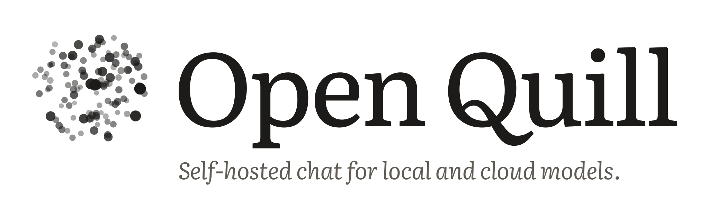
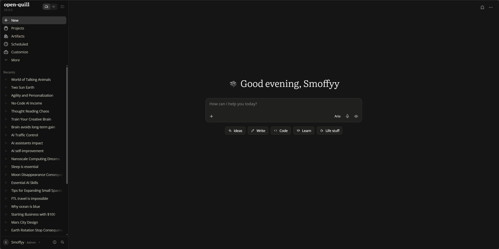

<p align="center">
  <picture>
    <source media="(prefers-color-scheme: dark)" srcset="press-kit/lockup/lockup-horizontal-tagline-on-dark.svg">
    <source media="(prefers-color-scheme: light)" srcset="press-kit/lockup/lockup-horizontal-tagline-on-light.svg">
    
  </picture>
</p>

<p align="center">
  <strong>Open Quill</strong> is a chat app for language models that runs on your own computer.
</p>

<p align="center">
  <a href="https://github.com/Smoffyy/open-quill/releases/latest"></a>
  <a href="https://github.com/Smoffyy/open-quill/actions/workflows/ci.yml"></a>
  <a href="LICENSE"></a>
</p>

<p align="center">
  
</p>

</br>

Connect it to a model running on your machine, like Ollama or llama.cpp, or to a cloud provider with your own API key. Nothing leaves your computer unless you set it up that way.

---

## Quickstart

### Install and run

You need [Node.js](https://nodejs.org/en/download/) 22.23.2 or newer.

```shell
git clone https://github.com/Smoffyy/open-quill.git
cd open-quill
npm run install:all
npm run build
npm start
```

Then open `http://localhost:3001` and create an account. The first account becomes the owner.

Connect a model under **Admin Panel → Providers**. A llama.cpp connection at `http://localhost:9931` is ready to use as a starting point.

Prefer not to build? Download the [latest release](https://github.com/Smoffyy/open-quill/releases/latest), which comes prebuilt. Run `npm install` in `server/`, then `npm start`.

### Let other people on your network in

Set `HOST=0.0.0.0` in `.env` and restart. Then turn on **Accept new sign-ups** under **Admin Panel → Members**.

## What it does

- Works with local and cloud models, including several at once
- Gives the assistant a workspace per chat, with files and a shell
- Projects, memory, scheduled tasks, web search and MCP connectors
- Team accounts with roles, and releases you can roll back
- Two interface styles, light and dark modes, ten languages

## Docs

- [**Getting Started**](docs/getting-started.md)
- [**Chatting**](docs/chatting.md)
- [**Models & Reasoning**](docs/models.md)
- [**Admin Guide**](docs/admin-guide.md)
- [**Privacy & Security**](docs/privacy-security.md)
- [**All documentation**](docs/README.md)

## Contributing

Report bugs in [Issues](https://github.com/Smoffyy/open-quill/issues) with your version from **Settings → Version**. Pull requests go to `dev`, with lint, build and tests passing. Architecture and conventions are in [AGENTS.md](AGENTS.md).

## License

Open Quill is released under the [MIT License](LICENSE). See [CREDITS.md](CREDITS.md) for the libraries and assets it uses.